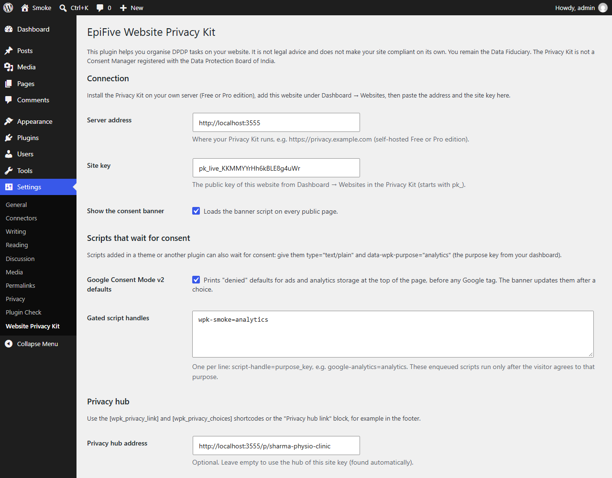

# EpiFive Website Privacy Kit for WordPress

<!-- epifive:header -->
> Add a DPDP consent banner, script gating and form consent checkboxes to WordPress, connected to your own Privacy Kit server.

**[Docs & guide on epifive.com](https://www.epifive.com/blog/website-privacy-kit-open-source-dpdp-consent-banner?utm_source=github&utm_medium=readme&utm_campaign=website-privacy-kit-wp)** · **[Download the latest release](https://github.com/epifive/website-privacy-kit-wp/releases/latest)** · [Pro edition](https://www.epifive.com/products/website-privacy-kit-pro?utm_source=github&utm_medium=readme&utm_campaign=website-privacy-kit-wp)

WordPress plugin that connects your site to your own
[EpiFive Website Privacy Kit](https://github.com/epifive/website-privacy-kit) server: a DPDP
consent banner, script gating, Google Consent Mode v2 defaults, privacy hub links and consent
checkboxes for forms (Contact Form 7, WPForms).

> **Not legal advice.** It helps you organise DPDP Act 2023 / DPDP Rules 2025 tasks; it does not
> make a website compliant on its own. You are the Data Fiduciary. Legal texts are drafts pending
> lawyer review. The Privacy Kit is not a Consent Manager registered with the Data Protection Board
> of India.

## Features

- Loads the banner (`w.js`) from your Privacy Kit server with your site key, async in the head.
- **Script gating:** `script-handle=purpose_key` lines turn enqueued scripts into
  `type="text/plain" data-wpk-purpose="…"`, so they run only after consent. Developers can use the
  `epifive_wpk_gated_handles` filter.
- **Google Consent Mode v2** "denied" defaults printed before any Google tag.
- `[wpk_privacy_link text="Privacy centre"]`, `[wpk_privacy_choices text="Privacy choices"]` and a
  **Privacy hub link** block.
- `[wpk_form_consent purposes="marketing_email" field="email"]` for any form, a
  `[wpk_consent marketing_email field:your-email]` Contact Form 7 form tag, and optional checkboxes
  in every Contact Form 7 or WPForms form. Choices are recorded in the consent log with the email.
- Translation-ready (`languages/`), Hindi included.
- No external calls except the server address you configure; no tracking.

## Install

1. Run a Privacy Kit server: Free (MIT) https://github.com/epifive/website-privacy-kit or Pro
   https://www.epifive.com/products/website-privacy-kit-pro. Hosted plans coming soon.
2. In its dashboard: publish your notice, add this website (Dashboard → Websites) and copy the site
   key. Add your WordPress domain as the website's domain or an allowed origin.
3. Copy this folder to `wp-content/plugins/epifive-website-privacy-kit/` (or upload `epifive-website-privacy-kit-wordpress-vX.Y.Z.zip` from the
   [latest release](https://github.com/epifive/website-privacy-kit-wp/releases/latest) in Plugins → Add New → Upload Plugin) and
   activate **EpiFive Website Privacy Kit**.
4. Settings → Website Privacy Kit: server address, site key, **Test connection**.

## Development

- PHP 7.4+ and WordPress 6.3+. `php -l` on every file; follows the WordPress coding standards
  (escaping, sanitising, nonces, prefixed names `epifive_wpk_` / `EpiFive_WPK_`).
- The block editor script (`blocks/privacy-link/index.js`) uses the `wp.*` globals: no build step.
- `readme.txt` is the WordPress.org listing.

More open-source projects: https://www.epifive.com/open-source ·
Custom setup: https://www.epifive.com/services#custom-app-development

## Contributing

Bug reports and pull requests are welcome: please open an
[issue](https://github.com/epifive/website-privacy-kit-wp/issues) first for larger changes, and run `php -l` on
every changed file before sending a PR.

## Licence

[GPL-2.0-or-later](LICENSE) © 2026 EpiFive

---

Made by <b>EpiFive</b> — <a href="https://www.epifive.com/?utm_source=github&utm_medium=readme&utm_campaign=website-privacy-kit-wp">www.epifive.com</a> · <a href="https://www.epifive.com/open-source?utm_source=github&utm_medium=readme&utm_campaign=website-privacy-kit-wp">more open-source projects</a>

